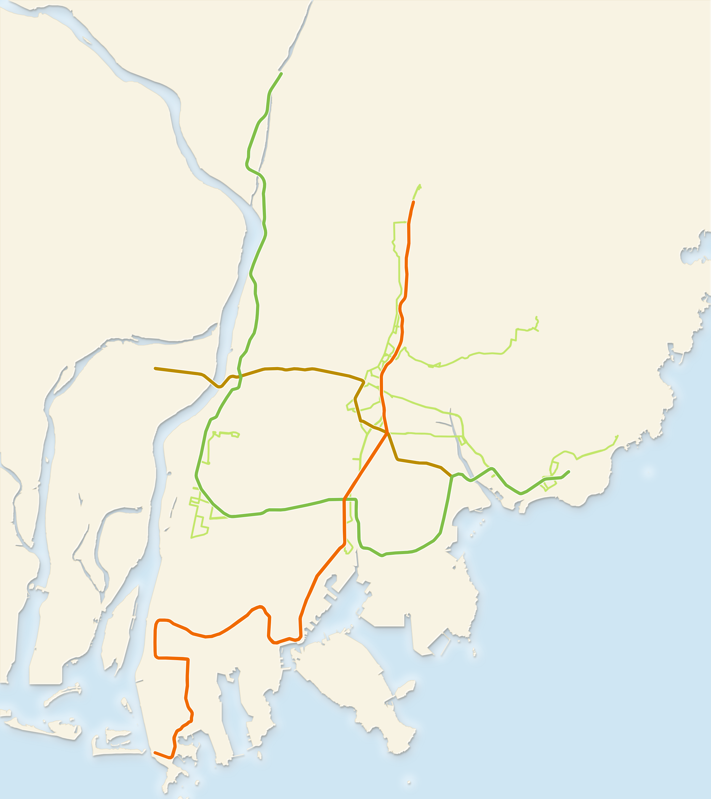

# mapofPusanonlyforMe

부산 지도. 표시하는 것은 아래뿐이고, 지명·도로·범례는 넣지 않았습니다.

- 육지: 연한 미색, 아래쪽에 그림자를 깔아 살짝 떠 보이게
- 바다·강: 연한 하늘색
- 도시철도 1·2·3호선: 각 노선 고유색 (주황 / 초록 / 갈색)
- 버스 금정7, 77, 100-1, 80, 31, 189번: 연두색

결과물: `busan_map.svg` (벡터), `busan_map.png` (2400px)

## 데이터

- 해안선, 강, 지하철 선로, 도로망: © OpenStreetMap contributors (ODbL), Overpass API
- 버스 정류장 순서와 좌표: 부산광역시_부산버스정보시스템 (공공데이터포털)

OpenStreetMap에는 6개 버스 노선 중 100-1번만 있어서, 버스는 공공데이터의 정류장 순서를
OSM 도로망 위에서 정류장 사이 최단 경로(일방통행 반영, 큰길 우선)로 이어 그렸습니다.

## 다시 만들기

1. 데이터: `.github/workflows/fetch-osm.yml`이 GitHub Actions에서 받아 `data/`에 커밋합니다.
   버스 정류장은 저장소 Secret `BUSAN_BIMS_KEY`(공공데이터포털 일반 인증키, Decoding)가 필요합니다.
2. 버스 노선: `python3 scripts/route_buses.py` → `data/bus_routes.json`
3. 지도: `python3 scripts/build_map.py` → `busan_map.svg`
4. PNG: `node scripts/render_png.js` → `busan_map.png` (Playwright 필요)
